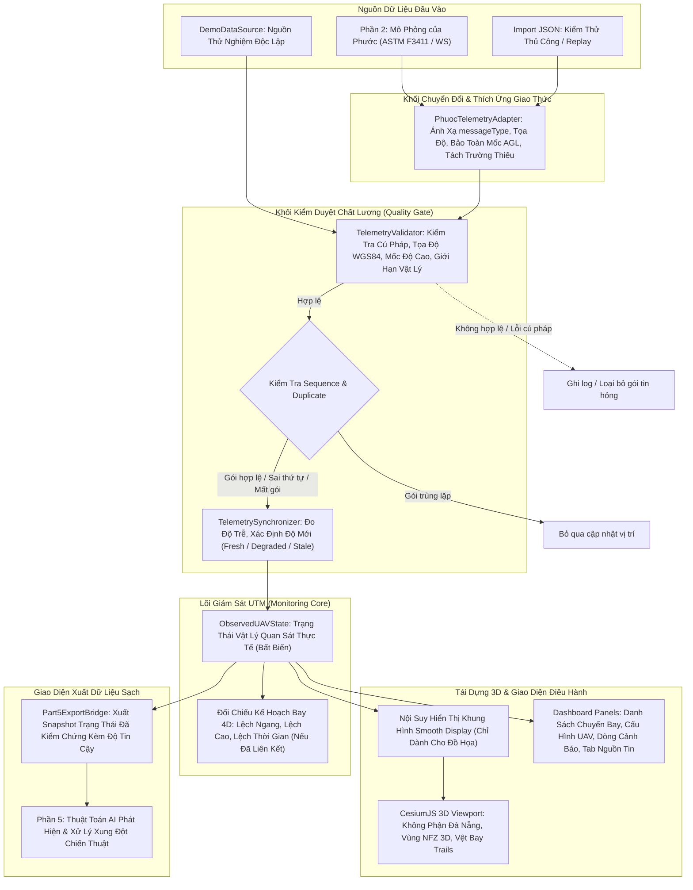

# ĐẶC TẢ HỢP ĐỒNG DỮ LIỆU & KIẾN TRÚC HỆ THỐNG GIÁM SÁT UTM 3D
> **Phần 4: Giám sát thời gian thực và tái dựng 3D (Đà Nẵng Airspace)**  
> **Phiên bản Hợp đồng:** `v1.0` & `ASTM F3411 Adapter` | **Hệ tọa độ:** WGS84 (EPSG:4326) | **Mốc độ cao:** MSL & AGL (Meters)

---

## 1. Sơ đồ Nhận và Xử lý Bản tin (Data Ingestion & Processing Pipeline)



---

## 2. Bảng Ánh xạ Bản tin Mô phỏng của Phước (ASTM F3411) sang UTM Monitoring

### 2.1. Bản tin Telemetry UAV của Phước
Dưới đây là cấu trúc bản tin gốc nhận được từ ảnh giao diện của Phước:

```json
{
  "messageType": "UAV_TELEMETRY",
  "timestamp": "2026-10-18T14:16:15.274Z",
  "simulationTimeSec": 71.2,
  "uav": {
    "id": "UAV-01",
    "callsign": "MED-EXPRESS-1",
    "type": "Multirotor",
    "position": {
      "longitude": 108.238596,
      "latitude": 16.067234,
      "altitudeAGL_m": 125
    },
    "movement": {
      "airSpeed_mps": 18,
      "groundSpeed_mps": 18,
      "headingDeg": 128.7,
      "driftAngleDeg": 0
    },
    "system": {
      "batteryPercent": 85,
      "flightMode": "AUTONOMOUS_UTM_CONTROL"
    }
  }
}
```

### 2.2. Bảng Chi tiết Ánh xạ Thuộc tính qua `PhuocTelemetryAdapter`

| Trường gốc của Phước | Trường đích UTM Monitoring | Kiểu dữ liệu | Quy tắc xử lý và Chuyển đổi |
| :--- | :--- | :--- | :--- |
| `messageType` | `type` | `"uav.telemetry"` | Nhận diện bản tin đo xa phương tiện bay |
| `uav.id` | `uav_id` | `string` | Giữ nguyên mã định danh (e.g. `"UAV-01"`) |
| `uav.callsign` | `callsign` | `string` | Tên hô hiệu liên lạc vô tuyến (e.g. `"MED-EXPRESS-1"`) |
| `uav.type` | `uav_profile.uav_type` | `UAVType` | `"Multirotor"` $\rightarrow$ `MULTIROTOR`, `"Fixed-wing"` $\rightarrow$ `FIXED_WING` |
| `uav.position.latitude` | `position.latitude` | `number` | Giữ nguyên vĩ độ WGS84 ($16.067234^\circ$) |
| `uav.position.longitude`| `position.longitude` | `number` | Giữ nguyên kinh độ WGS84 ($108.238596^\circ$) |
| `uav.position.altitudeAGL_m`| `position.altitude_m` | `number` | **Bảo toàn mốc AGL**: Gán `altitude_reference = 'AGL'`. Tuyệt đối không đánh đồng AGL với MSL |
| `uav.movement.groundSpeed_mps`| `velocity.ground_speed_mps` | `number` | Giữ nguyên tốc độ mặt đất ($18\text{ m/s}$) |
| `uav.movement.airSpeed_mps`| `velocity.air_speed_mps` | `number` | Tốc độ không khí tương đối ($18\text{ m/s}$) |
| `uav.movement.headingDeg`| `velocity.heading_deg` | `number` | Góc hướng mũi phương tiện ($128.7^\circ$) |
| `uav.movement.driftAngleDeg`| `velocity.drift_angle_deg` | `number` | Góc dạt do gió ($0^\circ$) |
| `uav.system.batteryPercent`| `battery_pct` | `number` | Tỷ lệ pin ($85\%$) |
| `uav.system.flightMode`| `flight_mode` | `string` | Chế độ bay (`"AUTONOMOUS_UTM_CONTROL"`) |
| `timestamp` | `timestamp` | `string` | Mốc thời gian ISO 8601 của simulator |
| `simulationTimeSec` | `simulation_time_sec` | `number` | Thời gian mô phỏng tương đối ($71.2\text{s}$) |

---

## 3. Báo cáo Các trường Dữ liệu Phước còn phải Cung cấp & Giải pháp Xử lý

| Trường dữ liệu | Tình trạng | Rủi ro nếu thiếu | Giải pháp kiến trúc của Phần 4 |
| :--- | :---: | :--- | :--- |
| **`sequence` (source)** | Chưa có | Không thể đo lường tỷ lệ rớt gói tin chính xác từ nguồn mô phỏng của Phước | Part 4 tự sinh `receive_sequence` nội bộ tăng dần, đánh dấu `is_inferred_sequence: true`. **KHÔNG dùng sequence này để kết luận Phước làm mất gói**. |
| **`flight_plan_id`** | Chưa có | Không thể biết UAV đang thực hiện kế hoạch bay 4D nào | Đánh dấu `is_unlinked_plan = true`, hiển thị "Chưa liên kết kế hoạch", **KHÔNG tự đối chiếu kế hoạch giả mạo**. |
| **`vertical_speed_mps`**| Chưa có | Khó phát hiện sớm nguy cơ xung đột leo/hạ cao thẳng đứng | Để `undefined` (hiển thị N/A trên UI), **KHÔNG tự giả định bằng 0**. |
| **`altitudeMSL_m`** | Chưa có | Thiếu mốc chuẩn mực nước biển WGS84 tuyệt đối | Giữ nguyên $125\text{m AGL}$, hiển thị rõ nhãn AGL trên 3D và dashboard, không đánh tráo khái niệm. |
| **`schema_version`** | Chưa có | Khó quản lý tương thích khi đổi định dạng | Gán nhãn nhận diện `'1.0-phuoc-adapter'`. |

---

## 4. Nhóm Bản tin Môi trường & Vùng hạn chế Không phận của Phước

Khi thành viên Phước gửi bản tin Môi trường (như tab "Chỉ bản tin Môi trường & Không phận" trong giao diện của Phước), `PhuocTelemetryAdapter` hỗ trợ:

### 4.1. Bản tin Trạng thái Môi trường Khí tượng (`ENVIRONMENT_STATE`)
```json
{
  "messageType": "ENVIRONMENT_STATE",
  "timestamp": "2026-10-18T14:16:20.000Z",
  "environment": {
    "windSpeed_mps": 6.5,
    "windDirectionDeg": 180,
    "temperatureC": 29.5,
    "visibilityKm": 12.0,
    "weatherCondition": "CLEAR"
  }
}
```

### 4.2. Bản tin Cập nhật Vùng hạn chế Không phận Động (`AIRSPACE_RESTRICTIONS`)
```json
{
  "messageType": "AIRSPACE_RESTRICTIONS",
  "timestamp": "2026-10-18T14:16:25.000Z",
  "zone": {
    "id": "NFZ-DYNAMIC-01",
    "name": "Khu vực thi công cầu Trần Thị Lý",
    "min_altitude_m": 0,
    "max_altitude_m": 150,
    "boundary": [
      { "latitude": 16.0520, "longitude": 108.2250 },
      { "latitude": 16.0520, "longitude": 108.2320 },
      { "latitude": 16.0460, "longitude": 108.2320 },
      { "latitude": 16.0460, "longitude": 108.2250 }
    ]
  }
}
```
*Tự động vẽ khối không gian 3D tường phát sáng trên CesiumJS ngay khi nhận được bản tin.*

---

## 5. Quy trình Kiểm thử với Bản tin của Phước

Hệ thống cung cấp 2 phương thức kiểm thử trực tiếp:

1. **Phương thức 1: Nhập JSON Thử nghiệm (Không cần WebSocket)**:
   - Nhấp vào nút **Nhập JSON Phước** trên thanh điều khiển TopBar.
   - Dán chuỗi JSON của Phước $\rightarrow$ Nhấp **Kiểm tra & Phân tích cấu trúc** $\rightarrow$ Xem bảng 3 nhóm trường (Nhận được, Suy ra, Còn thiếu) $\rightarrow$ Nhấp **Nạp vào bản đồ 3D & Theo dõi**.
2. **Phương thức 2: Kết nối Live WebSocket**:
   - Nhập URL WebSocket của Phước vào ô cài đặt.
   - Chọn định dạng: **Bộ mô phỏng Phước (ASTM F3411 Standard)** hoặc **Tự động nhận diện**.
   - Bật **Chế độ LIVE (WS)** $\rightarrow$ Dữ liệu được giải mã và tái dựng 3D thời gian thực.
