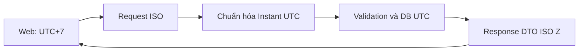

# SkyPermit UTM: tích hợp — bước 1

## Thời gian và tọa độ

- Request chấp nhận ISO datetime với `Z`, offset như `+07:00`, hoặc không offset.
  Không offset luôn được hiểu là UTC+7, độc lập múi giờ máy chủ.
- Response dùng ISO UTC có `Z`, gồm giờ bay, giờ waypoint trong `trajectoryJson`,
  thời điểm tạo/cập nhật/xóa và đăng nhập. Ví dụ `2027-01-01T09:00:00+07:00`
  và `2027-01-01T09:00:00` đều thành `2027-01-01T02:00:00Z`.
- Entity dùng `Instant`; DB giữ kiểu TIMESTAMP / SQL Server DATETIME2(6), chứa
  giờ UTC. Hibernate đọc/ghi với JDBC timezone UTC. Độ chính xác lưu trữ tối đa microsecond.
- DTO response giữ các tên trường, phân trang và đối tượng lồng hiện có; không trả
  trực tiếp entity hoặc passwordHash. `trajectoryJson` vẫn là chuỗi ở bước 1.
- Tọa độ WGS84, độ thập phân; vĩ độ ±90, kinh độ ±180. Độ cao không âm,
  đơn vị mét, AMSL. Cấu hình `utm.coordinates.reference-system=WGS84`,
  `utm.coordinates.altitude-reference=AMSL`, `utm.coordinates.altitude-unit=metres`
  khai báo quy ước triển khai; không thực hiện phép đổi hệ tọa độ/độ cao.
- Form web ghi rõ UTC+7, gửi UTC và hiển thị theo Asia/Ho_Chi_Minh,
  độc lập múi giờ trình duyệt. Validation thực hiện trên instant sau chuyển đổi.

## Migration dữ liệu trước bước 1

Trước khi chạy bản này, dừng các instance ứng dụng cũ. Không chạy đồng thời
bản cũ ghi giờ local và bản mới ghi UTC trên cùng DB.

1. Sao lưu DB trước triển khai. Với H2 đã tắt hoàn toàn, sao chép các file
   `data/utm-v2-db*` ra thư mục ngoài repository. Với SQL Server, quản trị DB tạo
   native backup và kiểm tra khả năng phục hồi trước khi khởi động phiên bản mới.
2. Bộ khởi tạo chạy `db/h2-time-marker.sql` hoặc `db/sqlserver-time-marker.sql`
   trước Hibernate. Script tạo bảng `utm_migrations` nếu chưa có.
3. `UtcDataMigration` kiểm tra khóa `utc-v1-legacy-plus07`. Nếu chưa có, thêm khóa,
   trừ 7 giờ các timestamp cũ trong năm bảng, chuyển thời gian JSON sang UTC.
   Các update và khóa đánh dấu dùng chung transaction. Dữ liệu JSON lỗi làm
   rollback toàn bộ; khởi động thất bại để người vận hành sửa dữ liệu rồi thử lại.
4. Lần khởi động tiếp theo thấy khóa sẽ bỏ qua. Không xóa khóa sau migration.
   Khi hai instance cùng khởi động lần đầu, khóa chính chặn chuyển đổi trùng;
   instance thua có thể cần khởi động lại sau khi instance đầu hoàn tất.
5. DB mới chưa có bảng nghiệp vụ được đánh dấu trước khi Hibernate/seed tạo dữ
   liệu UTC. Script `sqlserver-schema.sql` và script bổ sung doanh nghiệp đều
   bao gồm bảng đánh dấu; phần chuyển đổi dữ liệu do Java thực hiện để xử lý cả JSON.

H2 dạng file có bảng kế hoạch cũ còn được xuất `SCRIPT TO` vào file tạm ngoài
repo trước transaction chuyển đổi; đường dẫn xuất hiện trong log
`Pre-migration H2 SQL backup`. Đây là bản xuất SQL nhất quán qua kết nối H2,
không phải bản sao thô của file DB đang mở. Nếu xuất lỗi, không chuyển đổi dữ liệu.
Giữ bản xuất ở nơi riêng tư vì chứa dữ liệu DB; không đưa vào Git.

Tại thời điểm chuẩn bị bước 1, workspace không có `data/utm-v2-db*`, nên
không có bản sao file DB này để báo đường dẫn. Chỉ có `utm-flight-db*` thuộc
mô hình cũ; không mở hoặc thay đổi các file đó. Không có migration mô hình cũ.

Không đưa Flyway vào bước này để tránh baseline tự động trên các DB đang dùng
Hibernate update. Không chạy SQL trừ 7 giờ bằng tay song song với migration Java.
SQL Server chưa được kiểm chứng bằng server thật trong phiên làm việc này.

## Ví dụ API hiện có

Các API hiện vẫn dùng session; API key và các endpoint tích hợp sẽ bổ sung sau.

```bash
curl -c cookies.txt -H 'Content-Type: application/json' \
  -d '{"username":"<username>","password":"<password>"}' \
  http://localhost:8080/api/auth/login
curl -b cookies.txt http://localhost:8080/api/flights/active-or-approved
curl -b cookies.txt http://localhost:8080/api/flights/<flight-id>
```



## Việc còn lại

Form UAV tách `serialNumber` (số sê-ri thực tế), `droneType` (MULTIROTOR,
FIXED_WING, HYBRID) và `model` (tên mẫu). UUID do hệ thống sinh. Loại UAV bắt
buộc trên form web; API cũ được phép bỏ trường này để giữ tương thích. Khi sửa
qua API mà không gửi loại, loại hiện có được giữ nguyên. Dữ liệu cũ null hiển
thị "Chưa khai báo loại", không tự gán đa cánh quạt. `maxFlightTime` là số phút
nguyên dương; `maxSpeed` là m/s hữu hạn và lớn hơn 0 (km/h chia 3,6). Backend
từ chối số thập phân ở các trường số nguyên, tránh tự cắt phần lẻ. Schema bổ sung:
`h2-drone-type.sql`, `sqlserver-drone-type.sql`; startup áp dụng sau migration UTC.
Chưa kiểm tra tốc độ giữa các waypoint so với tốc độ tối đa UAV.

Bước 2–7 và 9: trajectory DTO, API key, PositionSource và nội suy, endpoint vị
trí, SSE, scheduler, OpenAPI và hoàn thiện tài liệu. Bỏ telemetry ở đợt này.
Các khác biệt mô hình nền được ghi trong [backlog.md](backlog.md).
