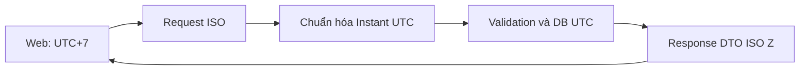

# SkyPermit UTM và tích hợp giám sát

## Kết nối thật với UTM Đà Nẵng 3D

Bật `utm.integration.mode=http` trong `application-local.properties`; đặt
`utm.integration.monitoring-url=http://127.0.0.1:8000/api/integration/flight-plans`
và `utm.integration.monitoring-token` bằng cùng `UTM_MONITORING_TOKEN` trên backend
3D (ít nhất 16 ký tự). Có thể dùng biến môi trường `UTM_INTEGRATION_MODE`,
`UTM_MONITORING_URL`, `UTM_MONITORING_TOKEN`. Không đưa khóa vào Git/trình duyệt.

Sau khi transaction duyệt/cập nhật/hủy đã commit, worker gửi các bản tin MONITORING
qua HTTP mỗi 3 giây (tối đa 20 bản tin/đợt, 5 lần thử). Header xác thực là
`X-UTM-Integration-Key`. Chỉ ghi `DELIVERED` khi nhận 2xx cùng JSON
`{"status":"ACCEPTED","eventId":"<đúng eventId đã gửi>"}`. Lỗi ghi `FAILED`, không
rollback kết quả duyệt. ADMIN có thể gửi lại cùng eventId; backend 3D chống lặp.
Bản tin đã cũ so với trạng thái chuyến bị đánh dấu `SUPERSEDED`. Mọi event đều có
đầy đủ snapshot, nên backend 3D có thể nhận ACTIVE/COMPLETED/CANCELLED mà chưa
nhận bản APPROVED. Không gửi lại bản chấp thuận cũ khi chuyến đã đổi trạng thái.

Chế độ http chỉ gửi MONITORING; SIMULATION giữ PENDING. Bản ghi mock cũ không
tự chuyển sang gửi thật; có thể retry bản MONITORING còn phù hợp trạng thái.
`mock` vẫn là mặc định và `disabled` giữ nguyên hành vi trước đây.

Backend 3D lưu kế hoạch trong SQLite và gửi snapshot/cập nhật qua
`ws://localhost:8000/ws/flight-plans`. Mở giao diện 3D ở chế độ LIVE để nhận kế
hoạch; vị trí UAV vẫn nhận từ WebSocket telemetry riêng. Các bản tin telemetry
phải có `uav_id=droneId`, `flight_plan_id=flightId` để so sánh với lộ trình Ops.
Không tạo vị trí quan sát từ kế hoạch đã duyệt.

Hướng dẫn đầy đủ ở dự án 3D: `UTM_OPS_INTEGRATION.md`.
Phần dưới ghi lại nền tảng mock và hợp đồng dữ liệu trước khi bổ sung HTTP.

## Luồng đã triển khai ngày 19 tháng 11 năm 2026

Operator khai báo UAV, chọn một hoặc nhiều UAV, nhập tên điểm đi/đến, thời gian và
quỹ đạo. ADMIN duyệt từng kế hoạch; người vận hành xem kết quả và tải JSON lộ trình.
Mô phỏng và giám sát được chuẩn bị bằng outbox lưu bền vững và phản hồi mock cục bộ.
Chưa tích hợp SITL/Gazebo, CesiumJS hoặc kiểm tra xung đột chiến lược bằng AI.

### Nộp và xét duyệt

`POST /api/flights/batch` nhận:

```json
{
  "droneIds": ["11111111-1111-4111-8111-111111111111", "22222222-2222-4222-8222-222222222222"],
  "departureName": "Bãi đáp A",
  "destinationName": "Bãi đáp B",
  "startTime": "2027-01-01T09:00:00+07:00",
  "endTime": "2027-01-01T09:10:00+07:00",
  "trajectoryJson": "[{\"latitude\":16.06,\"longitude\":108.22,\"altitude\":60,\"time\":\"2027-01-01T09:00:00+07:00\"},{\"latitude\":16.07,\"longitude\":108.23,\"altitude\":60,\"time\":\"2027-01-01T09:10:00+07:00\"}]"
}
```

UUID trên chỉ minh họa, phải thay bằng UAV thuộc operator đã đăng nhập. Tối đa
50 UUID không trùng. Cả đợt trong một transaction: một UAV không hợp lệ thì không
lưu kế hoạch nào. Response HTTP 201 là mảng `FlightPlanResponse`, mỗi UAV một
`id`, chung `submissionId`, `uavCount` do server tính. Mỗi kế hoạch được duyệt riêng;
không có giả định cả nhóm đã được duyệt khi chỉ một UAV được duyệt. Lộ trình chung
không chứng minh các UAV được phân cách an toàn. Tính năng kiểm tra giao cắt giữa
UAV thuộc khối chiến lược sẽ tích hợp sau.

Tên điểm đi/đến chỉ là nhãn; tọa độ lấy từ waypoint đầu/cuối. Độ cao mới 0–120 m
AGL; waypoint đầu/cuối khớp giờ cất/hạ cánh. Thời gian không vượt thời lượng tối đa
của bất cứ UAV nào được chọn. Một UAV không được nộp hai kế hoạch đang mở trùng
khoảng giờ; khóa UAV khi nộp để tránh hai yêu cầu đồng thời vượt kiểm tra.
API `POST /api/flights` vẫn nhận `droneId` cho một UAV, thêm hai tên tùy chọn;
các quy tắc kiểm tra mới cũng áp dụng cho endpoint này.

`PUT /api/flights/{id}/status` nhận `{"status":"APPROVED","reviewNote":"Đồng ý lộ trình"}`.
Chỉ ADMIN duyệt/từ chối; ghi `reviewedAt`, `reviewedBy`, `reviewNote` (tối đa 1000
ký tự). ADMIN/MANAGER cập nhật ACTIVE/COMPLETED. Không duyệt kế hoạch đã đến giờ
cất cánh, hoặc duyệt/kích hoạt khi UAV/người vận hành ngừng hiệu lực hay bị khóa.

### API tích hợp

| Endpoint | Quyền và kết quả |
| --- | --- |
| `GET /api/flights/{id}/accepted-plan` | Chủ kế hoạch hoặc staff; JSON snapshot lộ trình đã duyệt, chỉ khi kế hoạch còn hiệu lực và ở APPROVED/ACTIVE/COMPLETED |
| `GET /api/flights/{id}/integration` | Chủ kế hoạch hoặc staff; tối đa 100 bản tin của kế hoạch, mới nhất trước |
| `GET /api/integrations?status=FAILED` | ADMIN/MANAGER; tối đa 100 bản tin mới nhất, lọc PENDING/MOCK_DELIVERED/FAILED tùy chọn |
| `POST /api/integrations/{id}/retry` | ADMIN; gửi lại bản tin chưa nhận, không tạo bản sao; từ chối bản tin không còn phù hợp trạng thái kế hoạch |

Các endpoint dùng cookie session hiện có, chưa có API key/mạng service-to-service.
Snapshot duyệt là bất biến và không chứa email, số điện thoại hay mật khẩu. Hai
đích `SIMULATION`, `MONITORING` nhận cùng eventId/payload, có trạng thái tiếp nhận
riêng. Khóa duy nhất `(flight_id,target,event_type,flight_status)` tránh phát lặp
cùng sự kiện vòng đời. Thay đổi trạng thái kế hoạch và ghi outbox cùng transaction.

- Duyệt: `flightplan.accepted`.
- Hủy kế hoạch đã duyệt: `flightplan.cancelled`; kế hoạch PENDING bị hủy không
  phát bản tin vì chưa bàn giao cho bên nhận.
- Bắt đầu/kết thúc: `flightplan.status.changed`, kèm trạng thái ACTIVE/COMPLETED.

`UTM_INTEGRATION_MODE=mock` là mặc định: kiểm tra cấu trúc tối thiểu, lưu
`MOCK_DELIVERED`, số lần gửi, thời điểm và `receipt` có nhãn MOCK. Không có cuộc
gọi HTTP hoặc WebSocket ra ngoài, không tự đổi APPROVED thành ACTIVE.
`UTM_INTEGRATION_MODE=disabled` vẫn lưu bản tin PENDING, không tạo receipt.
Muốn nhận lại bản tin đã chờ, đổi cấu hình về mock, khởi động lại và ADMIN bấm
Gửi lại. Không có scheduler tự gửi trong đợt này. Payload lỗi được ghi FAILED;
bản tin chấp thuận chưa gửi bị từ chối retry khi đã qua giờ cất cánh. Bản tin đã có
receipt thành công không bị phát lại.

Hợp đồng: [JSON Schema](contracts/flightplan-event.schema.json),
[bản tin ví dụ](contracts/flightplan-accepted.example.json). Dữ liệu quỹ đạo ở
`flightPlan.waypoints` là mảng JSON, khác `trajectoryJson` là chuỗi ở API nộp.
Thông tin hệ tọa độ, mốc độ cao, đơn vị và UTC nằm trong `coordinateSystem`.
Khi thay mock bằng adapter thật, giữ eventId để bên nhận chống lặp, giữ snapshot
và phản hồi theo từng đích; cần bổ sung xác thực service, ACK/retry và đồng bộ trạng
thái. Bên nhận không được kích hoạt kế hoạch đã hủy dựa trên snapshot cũ.

Kế hoạch được duyệt từ phiên bản trước không có snapshot outbox vẫn tải được JSON
với `exportOnly:true`, `deliveryRecorded:false` và `eventId:null`; không bịa phản
hồi đã gửi. Snapshot đã lưu giữ nguyên các trường phê duyệt kể cả sau
ACTIVE/COMPLETED; trạng thái trong `flightPlan.status` phản ánh thời điểm duyệt.
Trường `currentStatus` ở ngoài snapshot cho biết trạng thái hiện thời khi tải.

### Schema bổ sung

Startup chạy script `db/h2-flight-integration.sql` hoặc
`db/sqlserver-flight-integration.sql` sau migration UTC hiện có, trước Hibernate.
Script chỉ thêm cột và bảng, không xóa dữ liệu. Với DB SQL Server có sẵn, tài khoản
khởi động cần quyền ALTER/CREATE hoặc quản trị DB áp dụng script trước. DB SQL
Server mới vẫn cần schema nền `db/sqlserver-schema.sql`. Chưa thực thi migration
trên DB trong phiên làm việc này.

Các script khởi động SQL Server được gửi nguyên mỗi file thành một JDBC batch
(`ScriptUtils.EOF_STATEMENT_SEPARATOR`) để giữ đầy đủ khối `IF ... BEGIN ... END`.
Không thêm lệnh `GO` của SSMS vào các script này. H2 vẫn tách các câu lệnh bằng
dấu `;`. Test hồi quy xác nhận cách chia/gửi script qua JDBC giả lập; không thay
thế kiểm tra thực thi migration trên SQL Server.

Các bản ghi có trước migration nhận `uavCount=1`, `submissionId=null`, không bịa
người duyệt hoặc tên điểm. Độ cao dữ liệu cũ giữ `AMSL`; kế hoạch mới ghi `AGL`.
Không đổi số độ cao cũ khi thiếu dữ liệu địa hình. Cả UI lẫn envelope hiển thị mốc
độ cao riêng của từng kế hoạch.

## Thời gian và tọa độ

- Request chấp nhận ISO datetime với `Z`, offset như `+07:00`, hoặc không offset.
  Không offset luôn được hiểu là UTC+7, độc lập múi giờ máy chủ.
- Response dùng ISO UTC có `Z`, gồm giờ bay, giờ waypoint trong `trajectoryJson`,
  thời điểm tạo/cập nhật/xóa và đăng nhập. Ví dụ `2027-01-01T09:00:00+07:00`
  và `2027-01-01T09:00:00` đều thành `2027-01-01T02:00:00Z`.
- Entity dùng `Instant`; DB giữ kiểu TIMESTAMP / SQL Server DATETIME2(6), chứa
  giờ UTC. Hibernate đọc/ghi với JDBC timezone UTC. Độ chính xác lưu trữ tối đa microsecond.
- DTO response giữ các tên trường, phân trang và đối tượng lồng hiện có; không trả
  trực tiếp entity hoặc passwordHash. `trajectoryJson` vẫn là chuỗi ở bước 1.
- Tọa độ WGS84, độ thập phân; vĩ độ ±90, kinh độ ±180. Kế hoạch mới dùng
  0–120 m AGL. Cấu hình `utm.coordinates.reference-system=WGS84`,
  `utm.coordinates.altitude-reference=AGL`, `utm.coordinates.altitude-unit=metres`.
  Kế hoạch cũ giữ AMSL qua trường `altitudeReference`; không thực hiện phép đổi độ cao.
- Form web ghi rõ UTC+7, gửi UTC và hiển thị theo Asia/Ho_Chi_Minh,
  độc lập múi giờ trình duyệt. Validation thực hiện trên instant sau chuyển đổi.

## Migration dữ liệu trước bước 1

Trước khi chạy bản này, dừng các instance ứng dụng cũ. Không chạy đồng thời
bản cũ ghi giờ local và bản mới ghi UTC trên cùng DB.

1. Sao lưu DB trước triển khai. Với H2 đã tắt hoàn toàn, sao chép các file
   `data/utm-v2-db*` ra thư mục ngoài repository. Với SQL Server, quản trị DB tạo
   native backup và kiểm tra khả năng phục hồi trước khi khởi động phiên bản mới.
2. Bộ khởi tạo chạy `db/h2-time-marker.sql` hoặc `db/sqlserver-time-marker.sql`
   trước Hibernate. Script tạo bảng `utm_migrations` nếu chưa có.
3. `UtcDataMigration` kiểm tra khóa `utc-v1-legacy-plus07`. Nếu chưa có, thêm khóa,
   trừ 7 giờ các timestamp cũ trong năm bảng, chuyển thời gian JSON sang UTC.
   Các update và khóa đánh dấu dùng chung transaction. Dữ liệu JSON lỗi làm
   rollback toàn bộ; khởi động thất bại để người vận hành sửa dữ liệu rồi thử lại.
4. Lần khởi động tiếp theo thấy khóa sẽ bỏ qua. Không xóa khóa sau migration.
   Khi hai instance cùng khởi động lần đầu, khóa chính chặn chuyển đổi trùng;
   instance thua có thể cần khởi động lại sau khi instance đầu hoàn tất.
5. DB mới chưa có bảng nghiệp vụ được đánh dấu trước khi Hibernate/seed tạo dữ
   liệu UTC. Script `sqlserver-schema.sql` và script bổ sung doanh nghiệp đều
   bao gồm bảng đánh dấu; phần chuyển đổi dữ liệu do Java thực hiện để xử lý cả JSON.

H2 dạng file có bảng kế hoạch cũ còn được xuất `SCRIPT TO` vào file tạm ngoài
repo trước transaction chuyển đổi; đường dẫn xuất hiện trong log
`Pre-migration H2 SQL backup`. Đây là bản xuất SQL nhất quán qua kết nối H2,
không phải bản sao thô của file DB đang mở. Nếu xuất lỗi, không chuyển đổi dữ liệu.
Giữ bản xuất ở nơi riêng tư vì chứa dữ liệu DB; không đưa vào Git.

Tại thời điểm chuẩn bị bước 1, workspace không có `data/utm-v2-db*`, nên
không có bản sao file DB này để báo đường dẫn. Chỉ có `utm-flight-db*` thuộc
mô hình cũ; không mở hoặc thay đổi các file đó. Không có migration mô hình cũ.

Không đưa Flyway vào bước này để tránh baseline tự động trên các DB đang dùng
Hibernate update. Không chạy SQL trừ 7 giờ bằng tay song song với migration Java.
SQL Server chưa được kiểm chứng bằng server thật trong phiên làm việc này.

## Ví dụ API hiện có

Các API dùng session; API key cho hệ thống ngoài sẽ bổ sung khi nối adapter thật.

```bash
curl -c cookies.txt -H 'Content-Type: application/json' \
  -d '{"username":"<username>","password":"<password>"}' \
  http://localhost:8080/api/auth/login
curl -b cookies.txt http://localhost:8080/api/flights/active-or-approved
curl -b cookies.txt http://localhost:8080/api/flights/<flight-id>
```



## Việc còn lại

Form UAV tách `serialNumber` (số sê-ri thực tế), `droneType` (MULTIROTOR,
FIXED_WING, HYBRID) và `model` (tên mẫu). UUID do hệ thống sinh. Loại UAV bắt
buộc trên form web; API cũ được phép bỏ trường này để giữ tương thích. Khi sửa
qua API mà không gửi loại, loại hiện có được giữ nguyên. Dữ liệu cũ null hiển
thị "Chưa khai báo loại", không tự gán đa cánh quạt. `maxFlightTime` là số phút
nguyên dương; `maxSpeed` là m/s hữu hạn và lớn hơn 0 (km/h chia 3,6). Backend
từ chối số thập phân ở các trường số nguyên, tránh tự cắt phần lẻ. Schema bổ sung:
`h2-drone-type.sql`, `sqlserver-drone-type.sql`; startup áp dụng sau migration UTC.
Chưa kiểm tra tốc độ giữa các waypoint so với tốc độ tối đa UAV.

Bước 2–7 và 9: trajectory DTO, API key, PositionSource và nội suy, endpoint vị
trí, SSE, scheduler, OpenAPI và hoàn thiện tài liệu. Bỏ telemetry ở đợt này.
Các khác biệt mô hình nền được ghi trong [backlog.md](backlog.md).
